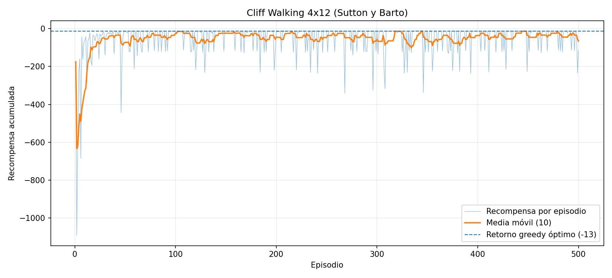

# Ejercicio 1 — Q-learning en Cliff Walking

## Configuración del experimento

Se implementó Q-learning tabular con selección de acciones ε-greedy en el entorno **Cliff Walking de 4 × 12 casillas**. El agente inicia en **S = (3, 0)** y debe alcanzar **G = (3, 11)**. Cada movimiento tiene recompensa de **−1**; si cae al acantilado, recibe **−100** y regresa a S sin terminar el episodio. La meta es el único estado terminal. Los empates en la elección de acciones se resuelven en el orden **N, E, S, W**.

| Parámetro | Valor |
|---|---:|
| Tasa de aprendizaje (α) | 0.5 |
| Factor de descuento (γ) | 1.0 |
| Exploración (ε) | 0.1 |
| Episodios de entrenamiento | 500 |
| Máximo de pasos por episodio | 200 |
| Q inicial | 0 |
| Semilla | 7 |

## Política aprendida y evaluación

Al finalizar el entrenamiento, la política **greedy (ε = 0)** alcanzó la meta en **13 pasos**, con un **retorno acumulado de −13**. El recorrido fue subir una casilla, avanzar 11 hacia el este por la fila 2 y bajar a la meta:

```text
fila 0    ·  ·  ·  ·  ·  ·  ·  ·  ·  ·  ·  ·
fila 1    ·  ·  ·  ·  ·  ·  ·  ·  ·  ·  ·  ·
fila 2    →  →  →  →  →  →  →  →  →  →  →  ↓
fila 3    S  C  C  C  C  C  C  C  C  C  C  G
```

**Acciones desde S:** `N E E E E E E E E E E E S`.

## Recompensa durante el entrenamiento

Se registró la recompensa acumulada de cada uno de los **500 episodios**, junto con una **media móvil de 10 episodios**. La recompensa promedio de los primeros 50 episodios fue **−118.22** y la de los últimos 50 fue **−39.62**. En **161 episodios** se obtuvo un retorno de **−13**, mientras que en los demás fue inferior. La última media móvil fue **−66.5**.



La serie completa está disponible en [`resultados/recompensas.csv`](resultados/recompensas.csv).

## Reporte breve

**¿Por qué el camino de 13 pasos, pegado al acantilado, es óptimo?**

El camino de 13 pasos es óptimo porque permite que el agente llegue desde el estado inicial **S = (3, 0)** hasta la meta **G = (3, 11)** utilizando la menor cantidad de movimientos posibles y evitando caer al acantilado. Para conseguirlo, primero debe subir una casilla hasta la fila 2, avanzar once posiciones hacia el este y finalmente bajar una casilla para alcanzar la meta. De esta manera, recorre la distancia necesaria sin realizar movimientos adicionales que aumenten la penalización acumulada.

Además, debido a que cada movimiento tiene una recompensa de −1 y el factor de descuento es γ = 1, el retorno total de este recorrido es de **−13**. Si el agente decide tomar una ruta más alejada del acantilado, necesitará más movimientos y, por lo tanto, obtendrá una recompensa acumulada menor. Por otra parte, intentar atravesar directamente el acantilado provoca una penalización de −100 y obliga al agente a regresar al inicio. Por estas razones, el recorrido por la fila inmediatamente superior al acantilado representa la mejor alternativa para alcanzar la meta.

**¿Por qué la curva de entrenamiento queda por debajo de −13 aunque la política greedy ya sea óptima?**

Durante el entrenamiento, el agente utiliza una estrategia ε-greedy con ε = 0.1, lo que significa que en cada decisión existe un 10 % de probabilidad de seleccionar una acción aleatoria. Esto permite explorar diferentes movimientos y aprender sus consecuencias, pero también provoca que el agente cometa errores incluso cuando ya ha encontrado un camino óptimo. Por ejemplo, puede retroceder, alejarse de la meta o moverse hacia el acantilado, acumulando penalizaciones que afectan el resultado del episodio.

En particular, caer al acantilado representa una pérdida considerable, ya que el agente recibe una recompensa de −100 y debe continuar nuevamente desde el estado inicial. Por esta razón, la recompensa obtenida durante el entrenamiento presenta variaciones importantes y puede mantenerse por debajo de −13. Esto se observa en los resultados, donde el promedio de los últimos 50 episodios fue de **−39.62**, a pesar de que la política aprendida ya permite completar el recorrido óptimo. En cambio, durante la evaluación greedy se desactiva la exploración (ε = 0), por lo que el agente selecciona únicamente las mejores acciones conocidas y consigue llegar a la meta en 13 pasos con un retorno de −13. Así, la diferencia entre ambos resultados se debe principalmente a que el entrenamiento incluye exploración y la evaluación no.

**Cuando el agente cae al acantilado, ¿cuál es `s'` en la actualización de Q-learning y por qué no se considera terminal?**

Cuando el agente realiza un movimiento que lo lleva a una casilla del acantilado, recibe una penalización de −100 y regresa inmediatamente al estado inicial. Por lo tanto, el siguiente estado utilizado en la actualización de Q-learning es **`s' = S = (3, 0)`**. Aunque el agente haya caído, el episodio no termina, ya que las reglas del entorno establecen que debe continuar intentando llegar a la meta desde el inicio.

Esto es importante porque Q-learning no solamente considera la recompensa inmediata de una acción, sino también la recompensa futura que podría obtener desde el siguiente estado. En este caso, la actualización utiliza el objetivo `−100 + γ max Q(S, a)`, donde se considera el mejor valor Q disponible desde el inicio. De esta forma, el agente aprende que caer al acantilado es una acción perjudicial, pero que todavía tiene la posibilidad de recuperarse y alcanzar la meta. Si el acantilado se considerara un estado terminal, el valor futuro sería cero y el entrenamiento terminaría después de cada caída, cambiando el comportamiento establecido para el ejercicio. Por el contrario, únicamente al llegar a **G** se termina el episodio y se utiliza un valor futuro de cero en la actualización.
